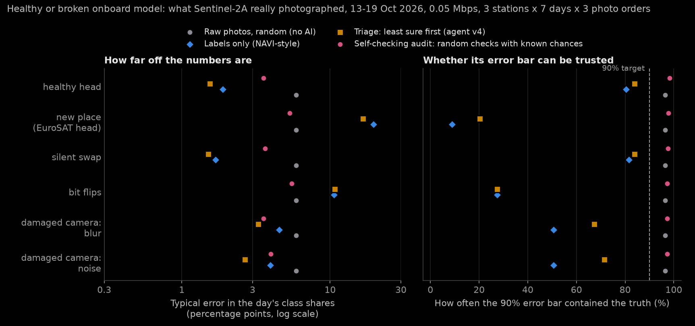
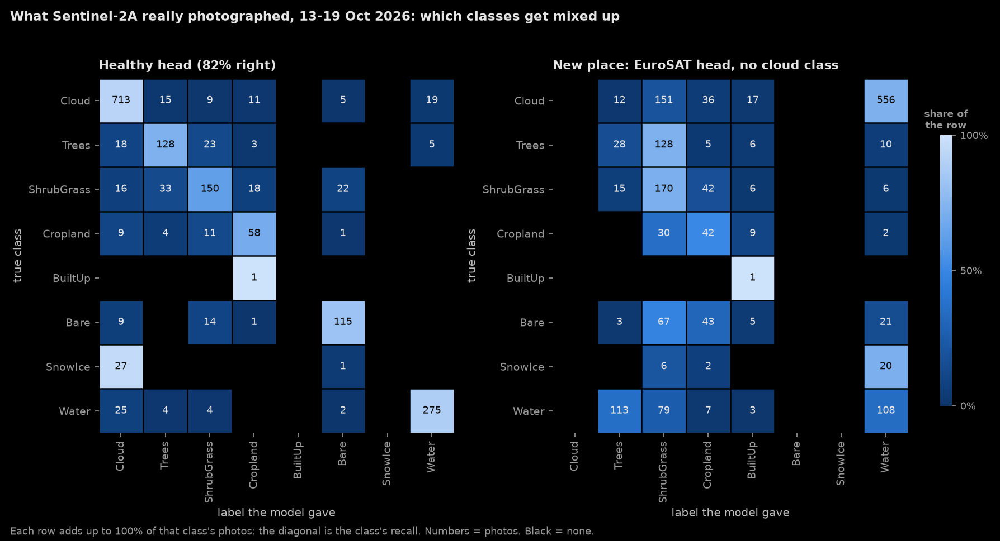
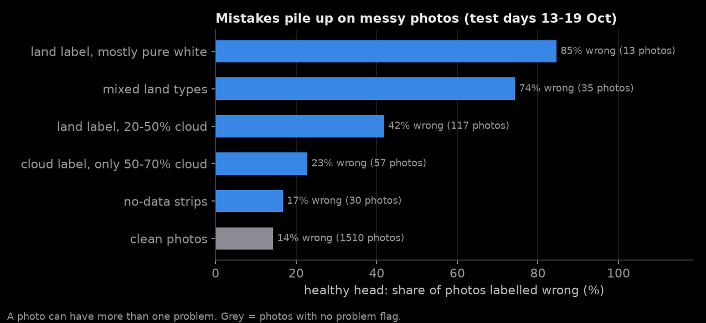

#  orbit-agent

**An AI agent that runs on a satellite and decides what is worth sending down to Earth.**

Frozen SigLIP + a 30 KB head onboard · random checks with known chances · real orbit and what Sentinel-2A really photographed · Python · laptop now, Jetson Orin later



## Main result: can the ground trust the numbers?

> On what Sentinel-2A really photographed (13-19 Oct 2026), when the onboard model breaks (a new place,
> radiation bit flips), its labels put the day's class shares **10-20 points off**, and their error bar
> holds only **9-27%** of the time. With the same bytes, the **self-checking audit** is 5-6 points off and its
> 90% error bar holds **97-98%** of the time.

Why not just "send the photos the model is unsure about" (the usual onboard-AI design, and this project's
agent v4)? Because then the photos it is
**sure** about are never checked. When the model is wrong in a **confident** way (a new camera, a radiation
bit flip, damaged optics), nothing on the ground can see it. Full reasoning:
[research review](notes/research_review_2026-10-20.md).

**New product:** the share of the day's photos in each class (cloud, cropland, water...) with a 90% error bar.
**New policy, the audit** (`src/agent/audit.py`): label every photo, then send full photos picked **at random
with known chances** (unsure photos more likely, every photo keeps a minimum chance). The ground corrects the
labels with the checked photos (`src/eval/estimate.py`): right on average **whatever the onboard model is like**.
**And it checks itself** (`src/agent/self_check.py`): if the checked mistakes are 1.5x bigger than the model
expected, the next passes run in **safe mode** (checks fully at random, chances recalibrated from past checks).

| EuroSAT replay, 0.25 Mbps, 63 days per cell | Labels only | Triage (agent v4) | **Self-checking audit** |
|---|---|---|---|
| Healthy head (93% right) | 0.7 points off, bar held 96% | **0.3**, 100% | 0.5, 98% |
| New camera (AID head, 28% right) | 10.8, **0%** | 8.0, **8%** | 2.0, 94% |
| Silent swap (wrong but as sure as right answers) | 4.4, 79% | 3.1, 80% | 1.0, 97% |
| Radiation bit flips in the 30 KB head | 1.4, 73% | 1.6, 80% | 1.3, 96% |
| Damaged camera (sensor noise) | 11.6, 7% | 7.8, 18% | 1.9, 94% |

- **Healthy model: agent v4's triage is the most accurate, but it can't tell you so.**
- **Broken model: labels and triage are off by up to 12 points, with error bars that almost never hold.**
  The audit stays honest (EuroSAT chart: `docs/audit_honesty.png`).
- **Real photos, real clouds:** `src/data/s2_real.py` replays what Sentinel-2A **really photographed** at each
  photo slot of its real path, 6-19 Oct 2026 (3,527 photos; the simulated times match the real images within
  0-7 s). Real Earth is 46% cloud and 0.1% built-up. With a head trained on 6-12 Oct (82% right), tested 13-19 Oct:

  | Real Sentinel-2A photos, 0.05 Mbps | Labels only | Triage (agent v4) | Random raw photos | **Self-checking audit** |
  |---|---|---|---|---|
  | Healthy head (82% right) | 1.9 points off, bar held 80% | 1.5, 84% | 5.9, 96% | 3.6, **98%** |
  | New place (EuroSAT head: no "cloud" class) | 19.5, **9%** | 16.6, **20%** | 5.9, 96% | **5.3, 98%** |
  | Radiation bit flips | 10.6, 27% | 10.8, 27% | 5.9, 96% | **5.5, 97%** |
  | Damaged camera (blur) | 4.5, 51% | 3.3, 67% | 5.9, 96% | 3.6, 97% |

  On real photos **even a healthy model's labels mislead** (their error bar holds 80%, 60% for rare classes).
- **The self-check was decided on EuroSAT only, then tested once on the real photos.** Without it, the audit was
  noisier than random raw photos when the model was badly broken (8.3 and 8.1 points vs 5.9), and with bit flips
  at 0.25 Mbps its bars held only 85%. With it: 5.3-5.5 points (better than raw) and 96-98% held. A healthy
  model almost never trips it (at most 3% of passes). Cost: at the tightest budget (0.02 Mbps) a few false
  switches made the silent-swap case worse (9.1 vs 5.7 points).
- **A floor of 0.5 is nearly free insurance** (`docs/audit_floor.png`): same error as checking only unsure photos
  when the model is healthy (0.47 points), but confident mistakes are caught (bit flips: bars hold 95% vs 86-88%).
- **Error bars that hold with no approximation** (22 Oct): the default bar ("scaled+1") uses a bell-curve
  approximation. It holds 94-98% on average, but one class in one setting can drop to 71-81%. A **betting**
  bar (Waudby-Smith & Ramdas 2023) needs no approximation and held for **every class in every setting**
  (90-100%, both replays). The price is width: 2.4x wider on the EuroSAT replay, 1.1x on real photos at 0.25 Mbps.
  Use it when a guarantee matters more than a narrow bar. `interval(e, "betting")` in `src/eval/estimate.py`.
- **When does onboard AI beat plain compression?** Re-save every photo as a smaller JPEG until the pass fits, and
  in the old replay range (R = data taken ÷ data sent = 1.4-5.6) every photo comes down and the class shares
  are exact: **onboard AI adds nothing there**. Above R ≈ 30 it wins clearly, and sending the checks as 160 px
  thumbnails gives 4-5x narrower honest error bars than compression (same bytes, same human checks).

  
- **A new camera with zero labels learns from its own audits** (`src/eval/audit_loop.py`): checked photos become
  training labels, the 30 KB head is retrained after every pass. On the real replay (0.1 Mbps), starting from
  the EuroSAT head (20% right), the new head reaches **77-83% right in 3-4 days from 164-215 checked photos**
  (a head trained before launch on 1,525 labels: 82%), and its error bars stay honest (held 96%). Keeping the
  launch head with triage: bars held 12%, one day 42 points off.

  

Details and every number: [experiment log](docs/experiment_log.md#audited-downlink-can-the-ground-trust-the-numbers-20-oct-2026-evening).
Second demo page: `demo/audit.html` ("the satellite reports its own error"; try a broken model to see safe mode).

## The problem
Satellites take far more photos than they can send to Earth. They can only talk to a ground
station for a few minutes per pass. Sentinel-2A can talk to Delhi only **1.4% of the time**
(2 passes a day, about 10 minutes each). So most photos are dropped or arrive late.

## The idea
Put a small AI model on the satellite. For each photo it gives a short label, like "farmland" or "cloud",
and a chance for every class. Labels are tiny (about 60 bytes vs 300 KB for a photo), so all of them fit.
Then the rest of each pass goes to **checks**: full photos picked at random with known chances (unsure
photos more likely, every photo keeps a minimum chance). On the ground, the checked photos show how wrong
the labels are, so the ground can correct the day's numbers and say how sure it is.

## How it works

```
 Real orbit data ──> Photo queue ──> Label + chances ──> Random checks ──> Ground pass ──> Class shares
   (TLE, Delhi)      (every 30 s)    (frozen SigLIP       with known         (budget =       + 90% error bar
                                      + 30 KB head)       chances            pass time        (corrected with
                                                                             x speed)          the checks)
```

1. **Orbit** (`src/orbit/`): real orbit data for Sentinel-2A gives the exact times the satellite can talk to Delhi.
2. **Photos** (`src/data/s2_real.py`): what Sentinel-2A really photographed at each 30 s slot of its real path
   (6-19 Oct 2026), or EuroSAT photos as stand-ins (`src/eval/audit_test.py`).
3. **Labeller** (`src/model/head.py`): a **frozen** SigLIP image model turns each photo into numbers, and a
   small classifier (30 KB) gives a chance for every class. 26 ms per photo on a MacBook.
4. **Audit** (`src/agent/audit.py`): labels for every photo, then random checks with known chances, exactly
   as many as fit in the pass.
5. **Ground** (`src/eval/estimate.py`): the day's class shares, corrected with the checks, with a 90% error bar.
   **Self-check** (`src/agent/self_check.py`): if the checks show the model is broken, switch to safe mode.
6. **Score** (`src/eval/audit_test.py`): how far the class shares are from the truth (points), and how often
   the 90% error bar really held.

## Onboard labellers: how often is each one right?

Same 300 final test photos (AID, 30 classes). This is accuracy only; the audit above is what makes the
ground's numbers trustworthy whichever labeller is on board.

| Labeller | Image model | Training photos | Labelled right | Calibration error (0 = perfect) | Speed |
|---|---|---|---|---|---|
| **Small head** (used on the real replay and in the demo) | SigLIP-base, 90M | 600 | 95.7% | 0.036 | 26 ms/photo (MacBook M2) |
| Big head | SigLIP so400m, 400M | 9,100 | **98.3%** | 0.021 | 420 ms/photo (Kaggle T4) |
| Tiny CNN, MobileNetV3-Small | 1.5M, all trained | 600 | 85.0% | 0.049 | ~1/300 of the small head's compute |
| SigLIP-base zero-shot (class names only) | 90M | 0 | 66.3% | 0.048 | 26 ms/photo |
| Gemma 3 4B (no training, like NAVI-Orbital) | 4B | 0 | 63% | | 7,500 ms/photo (MacBook) |

**A fair zero-shot rival for Gemma** (`python -m src.model.zeroshot`): SigLIP-base with class names only
("a satellite photo of forest."), no training photos. AID: **66.3%** (Gemma 3: 63%), Sentinel-2: **40.8%**
(Gemma 3: 29%), at 26 ms instead of 7.5 s.

The big head was trained on a free Kaggle GPU (`python -m src.cloud.kaggle_run`).
Files: `experiments/head_aid_siglip-base_n20_final.csv`, `experiments/head_aid_siglip_final.csv`,
`experiments/zeroshot_aid_siglip-base_final.csv`

**How well can Gemma's answers tell when Gemma is wrong?** (300 final test photos; Gemma got 63% right)

| Signal | Score (AUROC: 0.5 = guessing, 1 = perfect) | Wrong answers caught when flagging 10% / 20% / 30% | Extra cost |
|---|---|---|---|
| **B. Classes the model often confuses** | **0.77** | 20% / 34% / 50% | **none** |
| D. Agreement over 3 shuffled asks | 0.68 | 20% / 34% / 48% | 2 more model calls |
| C. Answer margin (token probability) | 0.63 | 15% / 31% / 42% | none |
| A. Model lists several answers | 0.50 | 8% / 18% / 26% | none |

File: `experiments/confidence_aid_test_gemma3-4b_r3_n10_skip20.csv` (+ `.png` chart)

## Beyond accuracy: confusion matrices and per-class scores

`python -m src.eval.metrics_report` scores every labeller with more than accuracy: balanced accuracy (every
class counts the same), precision / recall / F1 per class, macro-F1, Cohen's kappa, calibration error, and
Brier score (where every class's chance is known), plus the full confusion matrix of each one
(`experiments/confusion/*.csv`, rows = true class, columns = label given).

| | Accuracy | Balanced accuracy | Macro-F1 | Cohen's kappa | Calibration error | Brier |
|---|---|---|---|---|---|---|
| AID: small head | 95.7% | 95.7% | 95.6% | 0.955 | 0.036 | - |
| AID: tiny CNN | 85.0% | 85.0% | 84.9% | 0.845 | 0.049 | - |
| AID: SigLIP zero-shot | 66.3% | 66.3% | 63.8% | 0.652 | 0.046 | 0.452 |
| AID: Gemma 3 4B | 63.0% | 63.0% | 60.8% | 0.617 | - | - |
| Sentinel-2: small head | 92.8% | 92.8% | 92.8% | 0.920 | 0.016 | - |
| Sentinel-2: tiny CNN | 94.6% | 94.6% | 94.5% | 0.940 | 0.016 | - |
| **Real Sentinel-2A: healthy head** | 82.3% | 58.6% | 58.1% | 0.756 | 0.029 | 0.266 |
| Real: new place (EuroSAT head) | 20.0% | 34.1% | 14.1% | 0.072 | 0.652 | 1.391 |
| Real: bit flips | 57.5% | 34.6% | 36.7% | 0.442 | 0.331 | 0.798 |

- **On balanced test sets (AID, EuroSAT: equal photos per class) the metrics all agree with accuracy.**
- **On real photos they don't.** The healthy head is 82.3% right, but its balanced accuracy is only **58.6%**:
  it **never** says SnowIce or BuiltUp. All 28 snow photos become Cloud (snow and cloud look alike in colour
  photos, as the eye check found), and the training days had only ~15 snow and 3 built-up photos. Without
  those two classes its macro-F1 would be 77%. (BuiltUp has just 1 test photo; over the classes with at least
  5 test photos, balanced accuracy is 67.0%: see the data analysis below.) This is why the audit's class shares, with an error bar per
  class, are the product, not the labels.
- Most mixed-up pairs: real photos ShrubGrass -> Trees, SnowIce -> Cloud, Water -> Cloud; Sentinel-2 River ->
  Highway; AID (Gemma) Playground -> Stadium, Meadow -> Farmland.



More: `docs/confusion_eurosat.png` (small head vs tiny CNN), `docs/confusion_aid.png` (small head vs Gemma 3).
Files: `experiments/metrics_summary_*.csv`, `experiments/metrics_per_class_*.csv`.

## Is it a data problem? Exploratory data analysis

`python -m src.eval.eda` looks at the photos themselves (full report: [docs/eda.md](docs/eda.md)).

- **EuroSAT and AID are clean:** no duplicate photos, one photo size each, no broken files.
- **14% of the real Sentinel-2A photos are messy:** a land label on a 20-50% cloudy photo, mixed land types,
  no-data strips, or blown-out white. They are 14% of the test days but carry **30% of the mistakes**
  (error rate 42-85% vs 14% on clean photos).
- **Snow and cloud are both blown-out white** in 42 of 43 snow photos, so they can't be told apart in
  colour photos: a data limit (the infrared band would fix it).
- **The numbers are stable:** other day splits move accuracy by about 1 point (81.3-82.3%); cleaning the test
  photos adds about 3.5 points (85.7%). **The audit gives the same conclusions on clean photos**: broken
  models' labels still fail silently (bars hold 8-66%), the self-checking audit still holds 94-99%.



## What we learned
- **On real Sentinel-2 photos, the head must be trained on Sentinel-2 photos.** The AID-trained head
  gets only 33% on EuroSAT (Sentinel-2), about the same as Gemma (29%): it calls most blurry 64 px photos
  "bare land". Retraining just the small classifier on 1,000 Sentinel-2 photos (same frozen image model)
  gives **92.8%**.
  The big image model (400M) gets 94.8% there: 2 points more for about 15-20x the compute.
- **How many labelled photos are needed?** With only 5 per class, the frozen head gets 90% (AID) and
  79% (Sentinel-2); the tiny CNN gets 68% and 44%. On Sentinel-2 they meet at about 50 per class,
  and at 100 the CNN is ahead (95% vs 93%). A new satellite starts with few labels, so the frozen head
  fits the start of a mission; a tiny CNN fits later, once there are many labels.

  
- **A tiny CNN is the real competitor when there are enough labels.** MobileNetV3-Small (1.5M weights,
  trained end to end) gets 85.0% on AID with 20 photos per class (head: 95.7%), but 94.6% on Sentinel-2
  with 100 per class (head: 92.8%), at about 1/300 of the compute. The frozen head wins on label
  efficiency and on swapping missions with a 30 KB update; the CNN wins on compute.
  Details: [experiment log](docs/experiment_log.md#agent-v4-on-real-sentinel-2-photos-eurosat-20-oct-2026).
- **A trained head beats a big model with no training.** The small head gets 95.7% right vs Gemma's 63%,
  about 300x faster, and its chances are honest: all 13 photos it got wrong were among its least-sure 20%.
- **More accurate is not the same as more trustworthy.** The big head gets 98.3% right, but all 5 of its
  mistakes were over 96% sure. A rule like "check only the unsure photos" can never catch those. That is
  why the audit keeps a minimum chance of checking every photo.
- **The best "not sure" signal for Gemma is free.** "Is this a class the model often gets wrong?" needs
  no extra model call and scores best (AUROC 0.77). That matters on a satellite with little power.
- **Gemma is overconfident.** Its token probability is about 100% even when it's wrong, so that signal
  is weak. Asking 3 times and checking agreement works better.

## Fair testing
The AID photos are split into three sets that never mix:

| Photos (per class) | Used for |
|---|---|
| 1–10 | First baseline. Signal B learns which classes the model confuses here |
| 11–20 | Tuning: agent v3 learns its weights here; the v4 head picks its setting here |
| **21–30** | **Final test.** Only used once per model, for the accuracy results above |
| 31+ | Training photos for the heads only (Gemma never used them) |

**Overfitting check** (`python -m src.eval.overfit_check`): on 900 AID and 1,000 Sentinel-2 photos that
no model, setting or decision ever touched, the small head scores the same as on the final test
(AID 94.4% vs 94.3%, Sentinel-2 92.5% vs 92.7%). One honest caveat: the AID number moves between about
94% and 96% with tiny details (95% range ±2.5 points).

**Split by location** (`python -m src.eval.spatial_split`, 22 Oct): EuroSAT cuts neighbouring tiles from the
same scenes, so we feared a leak. Each photo's real coordinates (`src/data/eurosat_geo.py`) put it in a
10 km block, and whole blocks go to training or test. Result: **93.4% ± 0.6%** (3 seeds; 50 km blocks:
92.5% ± 0.3%) vs 92.7% with the random split. **No leak.** Even 50 km apart, two thirds of test photos have
a "near-twin" in training, so near-twins were just typical photos, not neighbours.

## Honest limits
- **The EuroSAT replay uses stand-ins.** Time, position and budget are real, but each photo slot gets a
  random EuroSAT photo with ASSUMED India-like class shares. The real replay (`src/data/s2_real.py`) fixes
  this: what Sentinel-2A really photographed at each slot (6-19 Oct 2026, real clouds), labelled by its
  cloud map and ESA WorldCover 2021 (a reference map with its own errors).
- **The real replay's labels come from maps, not people.** Eye check of 150 real photos
  (`python -m src.eval.label_check`, 22 Oct, done by an AI from contact sheets, so a person should re-check
  `experiments/label_check_real.csv`): where the eye could tell, **119 of 123 labels were right (97%)**. In
  RGB, snow and cloud can't be told apart (12 of 20 "SnowIce" photos), and half-cloudy photos get their land class.
- **The heads learned from labelled photos; Gemma saw none.** Compare them with that in mind. The fair zero-shot rival (SigLIP with class names) gets 66%
  on AID, a little above Gemma. On real Sentinel-2 photos (EuroSAT) the AID head drops
  to 33%; it needs about 1,000 labelled photos from the same kind of camera to reach 92.8%.
- **Gemma's accuracy is 61–65%** on AID's 30 classes, vs 88.16% for NASA JPL's NAVI-Orbital. NAVI cut AID
  to 18 classes; scored that way, our Gemma gets 76.5%. The rest of the gap fits their 18-option prompt,
  higher-resolution input and retries.
- **Laptop, not flight hardware.** Speeds are from a MacBook M2 and a Kaggle T4. Speed and power
  on a Jetson Orin are not measured yet. The script is ready: `python -m src.eval.jetson_bench` (image model
  + head + audit sampler; reads the Jetson's power meter). MacBook M2: 19 ms per photo at batch 8.
- **A checked photo is assumed to be read right on the ground** (by a person, or a stronger ground model).
- **One satellite.** Results hold over 7 days, 3 ground stations and 3 photo orders.
  Skipping cloudy photos and sending crops are not built yet.

## Demo
A web page that plays back one day of the satellite, using **real Sentinel-2 photos** (the EuroSAT
final test photos) and the small head trained on Sentinel-2: what the satellite sees, labels and queues.
The second page, `demo/audit.html`, shows the audit: can the ground trust its numbers?


Live: **https://devxsubh.github.io/orbit-agent/**

```bash
python -m src.demo.export      # makes demo/data.js and demo/thumbs/ (Sentinel-2 photos, agent v4)
open demo/index.html           # opens in the browser, no server needed
```
`python -m src.demo.export --photos aid` uses the AID photos instead, and
`--photos aid --agent "agent v3"` shows Gemma 3's labels.

What you see:
- **Map:** the satellite's path, the night side (no photos there), and the zone where it can talk to Delhi.
  Each photo is a dot: filled green = sure, amber ring = not sure.
- **Timeline:** drag it, or click a pass time (orange) to jump there.
- **Latest photo:** what the model says, the chance it's right (50% line = sure from here),
  the agent's choice, and the real answer (for checking only).
- **Waiting on the satellite:** photos queued for the next pass, and how many fit as full photos.
  During a pass you see the full photos going down.

Keys: Space = play/pause, N = next pass, ← → = 1 minute. Passes play slower so you can watch them.
`index.html?t=60000` opens at a set time (seconds after the start).

**Colours mean the same thing everywhere on the demo page:** blue = satellite and downlink,
orange = ground station and passes, green = sure or correct, amber = not sure, red = wrong.

## Run it yourself
Tested on macOS (Apple Silicon, 8 GB). Needs Python 3.10+, and [Ollama](https://ollama.com) with a Gemma 3 model (`ollama pull gemma3:4b`).

```bash
./setup.sh                              # makes .venv, installs packages, downloads papers
source .venv/bin/activate
python check_setup.py                   # health check

python -m src.orbit.contact_windows     # passes over Delhi in the next 24 h, + map
python -m src.data.aid                  # download AID photos 1-10 per class (85 MB)
python -m src.data.aid --skip 20        # download the final test photos 21-30
python -m src.eval.confidence_test --skip 20   # model + "not sure" signals (~2 h, resumable)
python -m src.model.head --backbone siglip-base --train-per-class 20   # agent v4 head (~15 min first time)
python -m src.cloud.kaggle_run          # or: big head on a free Kaggle GPU (push your code first)
python -m src.eval.sentinel_test        # the head on real Sentinel-2 photos (EuroSAT, ~10 min)

# Audited downlink (20 Oct)
python -m src.data.s2_real              # what Sentinel-2A really photographed, 6-19 Oct (~1-2 h, resumable)
python -m src.eval.estimate             # self-test of the ground estimators on made-up data (10 s)
python -m src.eval.audit_test           # audit vs today's policies, healthy or broken model (EuroSAT, ~5 min)
python -m src.eval.audit_test --data real   # the same on the real Sentinel-2A replay
python -m src.eval.audit_floor          # how much to spend on checks (~5 min)
python -m src.eval.compress_test        # R sweep: onboard AI vs plain compression (~3 min)
python -m src.eval.audit_loop --data real   # new camera, zero labels, learns from its own audits
python -m src.eval.audit_tables         # every table above as markdown, from the saved CSVs
python -m src.eval.plot_audit           # redraws docs/audit_*.png
python -m src.demo.export_audit && open demo/audit.html   # second demo page

# Fixes (22 Oct)
python -m src.model.zeroshot            # fair zero-shot rival: SigLIP with class names only (seconds)
python -m src.eval.label_check          # contact sheets to check the real labels by eye; --summary after
python -m src.data.eurosat_geo          # where each EuroSAT photo is (one 2 GB stream, nothing big saved)
python -m src.eval.spatial_split        # Sentinel-2 accuracy with a test split by location (~5 min)
python -m src.eval.jetson_bench         # time (and on a Jetson, energy) of the onboard steps
python -m src.eval.metrics_report       # confusion matrices, per-class precision/recall/F1, kappa, Brier (~1 min)
python -m src.eval.eda                  # exploratory data analysis: data problems, label checks, how much numbers move (~1 min)
```

More commands (EuroSAT, prompts, image sizes, replay options) are in [docs/experiment_log.md](docs/experiment_log.md).

## Project layout
| Path | What it is |
|---|---|
| `src/orbit/` | Orbit simulator (passes, budget per pass) and the photo replay |
| `src/data/` | Downloads AID (Hugging Face) and EuroSAT (Zenodo) |
| `src/model/` | Gemma 3 via Ollama, the "not sure" signals, and the v4 decision head |
| `src/agent/` | The agents (v1-v4), the baselines, and the audited downlink (`audit.py`) |
| `src/cloud/` + `kaggle/` | Runs the decision-head training on a free Kaggle GPU |
| `src/eval/` | Accuracy tests, the audit experiments, error bars, charts |
| `src/demo/` + `demo/` | Demo export and the playback page |
| `experiments/` | Every run's results (CSV + charts) |
| `docs/` | README images and the full experiment log |
| `papers/`, `notes/` | Reading list and paper notes |

## Status
- [x] Orbit simulator with real orbit data
- [x] Model running locally: EuroSAT (about 30%, photos too small) and AID (61–65%)
- [x] Photo replay along the real orbit
- [x] Agent v1 (rules), v2 and v3 ("not sure"-aware)
- [x] Decision head (frozen SigLIP + small classifier): 95.7% right on unseen AID photos
- [x] Test the decision head on real Sentinel-2 photos (EuroSAT): AID head 33%, retrained head **92.8%**
- [x] Demo page
- [x] Check NAVI's setup to compare accuracy fairly (their 18 classes: our Gemma 76.5%); fair zero-shot rival (SigLIP 66%)
- [x] Audited downlink: honest class shares even with a broken onboard model (20 Oct)
- [x] Replay of what Sentinel-2A really photographed (real clouds and places, 6-19 Oct 2026)
- [x] Compression baseline and R sweep; closed loop for a new camera with zero labels
- [x] Second demo page: `demo/audit.html`
- [x] Self-checking audit: switches to safe mode when its checks show the model is broken
- [x] Error bars that always hold for rare classes at the tightest budgets (betting intervals; 1.1-2.4x wider)
- [x] Sentinel-2 test split by location: 93.4% (random split 92.7%), no leak
- [x] Real labels checked by eye, first pass (97% where the eye could tell; a person should re-check)
- [ ] Skip cloudy photos, send crops
- [ ] Run on a Jetson Orin Nano (speed and power): script ready (`src/eval/jetson_bench.py`), needs the board
- [ ] Demo video
- [ ] Paper draft (outline: `paper/outline_v2_audit.md`)

## Built on
- **NAVI-Orbital** (NASA JPL, arXiv 2606.18271): the first vision-language model run fully in orbit
  (Gemma 3 on a Jetson Orin, April 2026). This project asks the next question: *what should it send down?*
- **Kodan** (ASPLOS 2023): onboard processing cut downlink by about 89–97%.
- **TypeSafe's Jev** (Sep 2026) and open copies like Laya and OpenJev: "decision models" that score a
  fixed list of answers in one pass. Agent v4 applies the idea to photos with a frozen SigLIP model.
- **On-Orbit Space AI survey** (arXiv 2604.16518): names trust in orbit and "what to send down" as open problems.
- Datasets: **AID** (30 classes, 600x600 px aerial photos) and **EuroSAT** (Sentinel-2, 64x64 px).

Full reading list: [papers/README.md](papers/README.md).
Full history of every experiment: [docs/experiment_log.md](docs/experiment_log.md).
