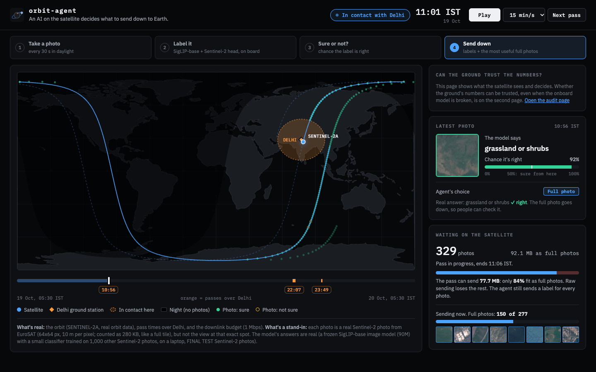
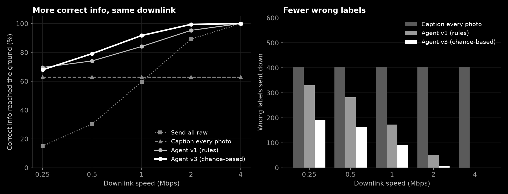
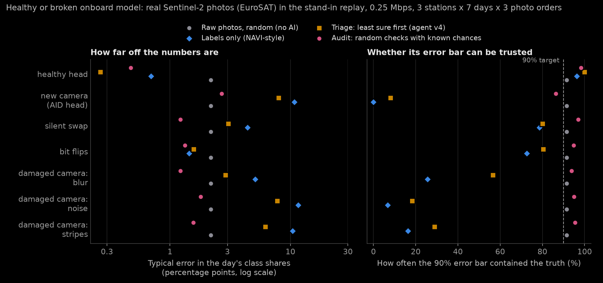
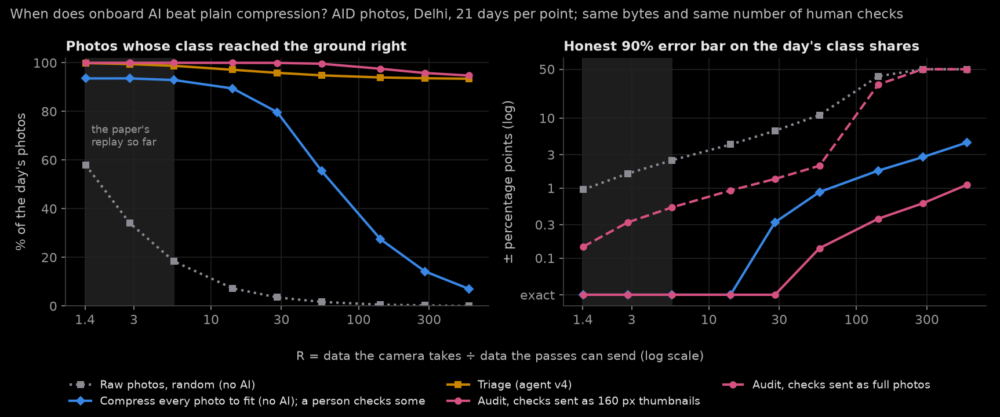
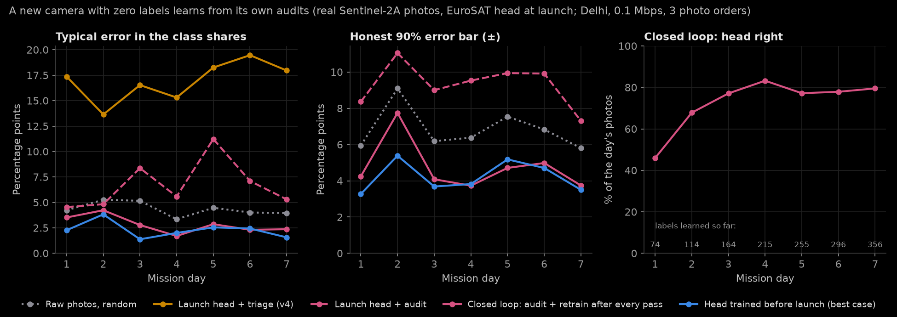
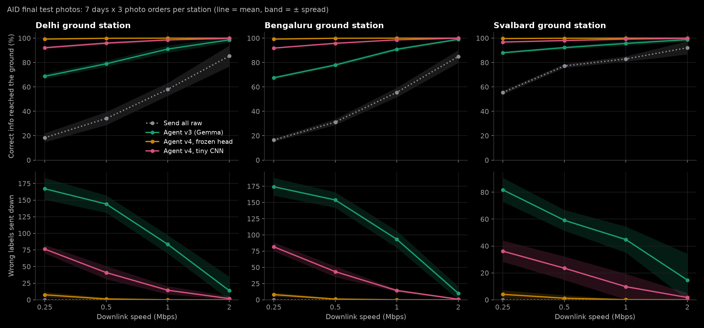
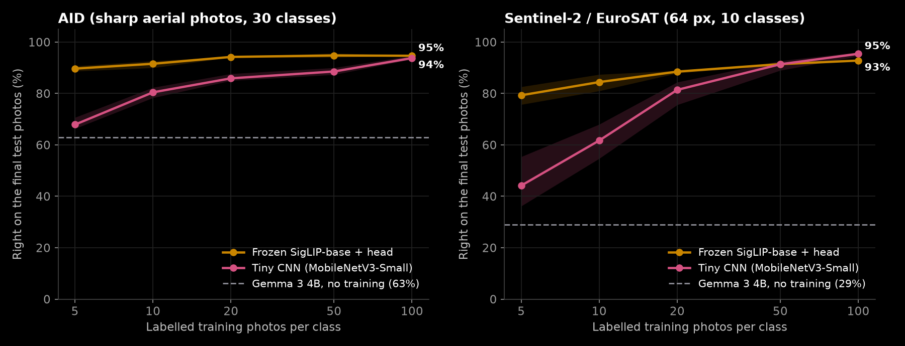
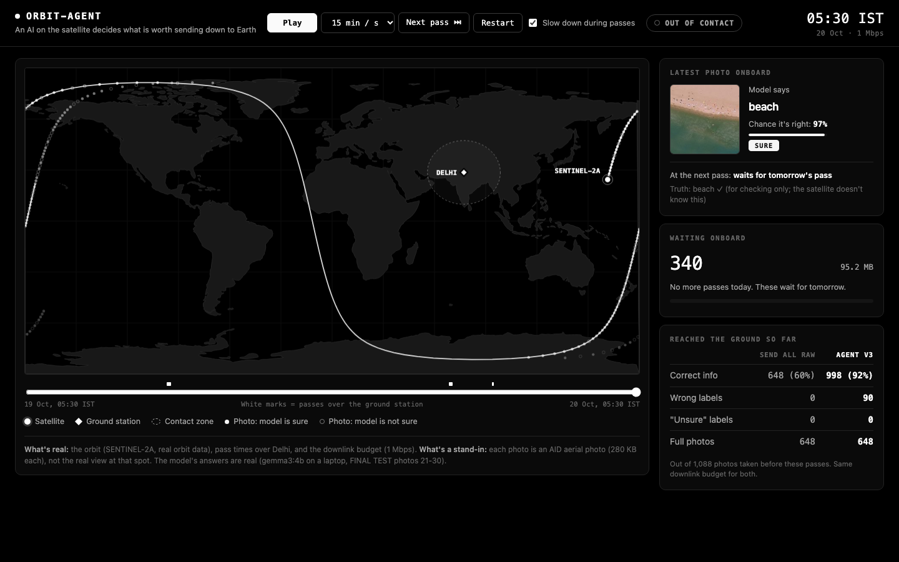

#  orbit-agent

**An AI agent that runs on a satellite and decides what is worth sending down to Earth.**

Gemma 3 (4B) vision-language model + a Jev-style decision head (frozen SigLIP) · real orbit data · Python · laptop now, Jetson Orin later



## Main result

> With the same downlink budget (1 Mbps), **agent v4** gets **100%** of the information to the
> ground correctly, with **0 wrong labels**. Sending raw photos gets **60%**.
> Agent v3, which uses Gemma 3 with no training at all, gets 92% with 90 wrong labels.

Agent v4 labels photos with a small **decision head**: a frozen image model plus a tiny classifier
trained on other AID photos. It takes 26 ms per photo, compared with 7.5 s for Gemma 3. Gemma never
saw a labelled photo, so v3 vs v4 is not a like-for-like contest (see [Honest limits](#honest-limits)).



Tested on **photos never used while building the agent** (see [Fair testing](#fair-testing)).

## New (20 Oct): can the ground trust the numbers? The audited downlink

The main result above has two catches. Its score counts a 50-byte label and a 280 KB photo as the same
"1 correct", so any good labeller scores about 100%. And agent v4 only checks the photos it is **unsure**
about, so when the model is wrong in a **confident** way (a new camera, a radiation bit flip, damaged
optics), nothing on the ground can see it. Full reasoning: [research review](notes/research_review_2026-10-20.md).

**New product:** the share of the day's photos in each class (cloud, cropland, water...) with a 90% error bar.
**New policy, the audit** (`src/agent/audit.py`): label every photo, then send full photos picked **at random
with known chances** (unsure photos more likely, every photo keeps a minimum chance). The ground corrects the
labels with the checked photos (`src/eval/estimate.py`): right on average **whatever the onboard model is like**.



| EuroSAT replay, 0.25 Mbps, 63 days per cell | Labels only | Triage (agent v4) | **Audit** |
|---|---|---|---|
| Healthy head (93% right) | 0.7 points off, bar held 96% | **0.3**, 100% | 0.5, 98% |
| New camera (AID head, 28% right) | 10.8, **0%** | 8.0, **8%** | 2.7, 86% |
| Silent swap (wrong but as sure as right answers) | 4.4, 79% | 3.1, 80% | 1.2, 97% |
| Radiation bit flips in the 30 KB head | 1.4, 73% | 1.6, 80% | 1.3, 95% |
| Damaged camera (sensor noise) | 11.6, 7% | 7.8, 18% | 1.8, 95% |

- **Healthy model: agent v4's triage is the most accurate, but it can't tell you so.**
- **Broken model: labels and triage are off by up to 12 points, with error bars that almost never hold.**
  The audit stays honest and is never much worse than sending random raw photos.
- **Real photos, real clouds:** `src/data/s2_real.py` replays what Sentinel-2A **really photographed** at each
  photo slot of its real path, 6-19 Oct 2026 (3,527 photos; the simulated times match the real images within
  0-7 s). Real Earth is 46% cloud and 0.1% built-up. With a head trained on 6-12 Oct (82% right), tested 13-19 Oct:

  | Real Sentinel-2A photos, 0.05 Mbps | Labels only | Triage (agent v4) | **Audit** |
  |---|---|---|---|
  | Healthy head (82% right) | 1.9 points off, bar held 80% | 1.5, 84% | 3.5, **99%** |
  | New place (EuroSAT head: no "cloud" class) | 19.5, **9%** | 16.6, **20%** | 8.3, 97% |
  | Radiation bit flips | 10.6, 27% | 10.8, 27% | 8.1, 91% |
  | Damaged camera (blur) | 4.5, 51% | 3.3, 67% | 3.7, 97% |

  On real photos **even a healthy model's labels mislead** (their error bar holds 80%, 60% for rare classes).
  The honest price: with a badly broken model the audit is noisier than random raw photos (8.3 vs 5.9 points),
  because its check chances come from that model. Chart: `docs/audit_honesty_real.png`.
- **A floor of 0.5 is nearly free insurance** (`docs/audit_floor.png`): same error as checking only unsure photos
  when the model is healthy (0.47 points), but confident mistakes are caught (bit flips: bars hold 95% vs 86-88%).
- **When does onboard AI beat plain compression?** Re-save every photo as a smaller JPEG until the pass fits, and
  in the old replay range (R = data taken ÷ data sent = 1.4-5.6) every photo comes down and the class shares
  are exact: **onboard AI adds nothing there**. Above R ≈ 30 it wins clearly, and sending the checks as 160 px
  thumbnails gives 4-5x narrower honest error bars than compression (same bytes, same human checks).

  
- **A new camera with zero labels learns from its own audits** (`src/eval/audit_loop.py`): checked photos become
  training labels, the 30 KB head is retrained after every pass. On the real replay (0.1 Mbps), starting from
  the EuroSAT head (20% right), the new head reaches **77-83% right in 3-4 days from 164-215 checked photos**
  (a head trained before launch on 1,525 labels: 82%), and its error bars stay honest (held 96%). Keeping the
  launch head with triage: bars held 12%, one day 42 points off.

  

Details and every number: [experiment log](docs/experiment_log.md#audited-downlink-can-the-ground-trust-the-numbers-20-oct-2026-evening).
Second demo page: `demo/audit.html` ("the satellite reports its own error").

## The problem
Satellites take far more photos than they can send to Earth. They can only talk to a ground
station for a few minutes per pass. Sentinel-2A can talk to Delhi only **1.4% of the time**
(2 passes a day, about 10 minutes each). So most photos are dropped or arrive late.

## The idea
Put a small AI model on the satellite. For each photo it gives a short label, like "airport" or
"farmland", and the chance that the label is right. Labels are tiny (about 50 bytes vs 280 KB for a photo), so all of them fit.
The agent then decides what else to send:

- **Sure about the label?** The label is enough.
- **Not sure?** Mark the label "unsure", so nobody on the ground trusts a guess.
- **Budget left?** Send full photos where they add the most, starting with the ones the model is least sure about.

## How it works

```
 Real orbit data ──> Photo queue ──> Label + chance it's right ──> Agent ──> Ground pass
   (TLE, Delhi)      (every 30 s)    v4: decision head (26 ms)     decides     (budget =
                                     v1-v3: Gemma 3 4B (7.5 s)     what goes   pass time
                                                                   down        x speed)
```

1. **Orbit** (`src/orbit/`): real orbit data for Sentinel-2A gives the exact times the satellite can talk to Delhi.
2. **Photo replay** (`src/orbit/replay.py`): a photo every 30 s in daylight gives 1,088 photos (304 MB) per day.
   At 1 Mbps, raw sending fits only 60% of them.
3. **Decision head, agent v4** (`src/model/head.py`): the idea comes from "decision models" like
   TypeSafe's Jev. The answers are fixed in advance (30 classes), and one quick pass gives a chance
   for every answer, with no text generated. A **frozen** SigLIP image model turns each photo into
   numbers, and a small classifier trained on top picks the class. 26 ms per photo on a MacBook.
4. **Gemma 3, agents v1-v3** (`src/model/vlm.py`, `src/model/confidence.py`): Gemma 3 4B (Ollama, 4-bit)
   labels each photo with no training, about 7.5 s per photo. Its chance of being right comes from
   a free signal (classes it often mixes up) plus whether 3 shuffled asks agree.
5. **Agent** (`src/agent/decide.py`): plain label if the chance is at least 50%, else an "unsure" label.
   Leftover budget goes to full photos, best value per byte first (v3 and v4 plan the same way).
6. **Score** (`src/eval/`): correct info, wrong labels and MB sent, always reported together.

## Final results

Same day of orbit (1,088 photos), same budget for every policy. Each cell: **correct info / wrong labels**.

| Downlink | Send all raw | Caption every photo | Agent v1 (rules) | Agent v2 | Agent v3-lite (1 call) | Agent v3 (3 calls) | **Agent v4** (decision head) |
|---|---|---|---|---|---|---|---|
| 0.25 Mbps | 15% / 0 | 63% / 404 | 70% / 331 | 58% / 132 | 65% / 204 | 68% / 192 | **100% / 3** |
| 0.5 Mbps | 30% / 0 | 63% / 404 | 74% / 282 | 72% / 129 | 78% / 167 | 79% / 164 | **100% / 0** |
| **1 Mbps** | **60% / 0** | 63% / 404 | 84% / 173 | 89% / 85 | 91% / 99 | 92% / 90 | **100% / 0** |
| 2 Mbps | 89% / 0 | 63% / 404 | 95% / 51 | 97% / 29 | 99% / 7 | 99% / 6 | **100% / 0** |
| 4 Mbps | 100% / 0 | 63% / 404 | 100% / 0 | 100% / 0 | 100% / 0 | 100% / 0 | 100% / 0 |

Files: `experiments/agents_delhi_final_equal_20261019_1229.csv` (v1-v3),
`experiments/agents_delhi_final_equal_20261020_0947.csv` (v4, small head)

**Does this hold on other days and stations?** Yes. Over 7 days x 3 ground stations x 3 photo orders
(21 runs per station), at 1 Mbps over Delhi: raw 58.0 ± 5.3%, agent v3 91.1 ± 3.0% (83 ± 14 wrong),
frozen head 100.0 ± 0.0% (0 wrong). The order of the policies never changes. At Svalbard (polar, 12 passes
a day) raw already gets 83%, so the agent helps most at low-latitude stations like Delhi and Bengaluru.



**Two decision heads** (same 300 final test photos):

| Head | Image model | Training photos | Labelled right | Calibration error (0 = perfect) | Speed | Replay at 1 Mbps |
|---|---|---|---|---|---|---|
| **Small** (used above and in the demo) | SigLIP-base, 90M | 600 | 95.7% | 0.036 | 26 ms/photo (MacBook M2) | 100% / 0 wrong |
| Big | SigLIP so400m, 400M | 9,100 | **98.3%** | 0.021 | 420 ms/photo (Kaggle T4) | 100% / 3 wrong |
| *Tiny CNN, MobileNetV3-Small (baseline)* | *1.5M, all trained* | *600* | *85.0%* | *0.049* | *~1/300 of the small head's compute* | *99% / 12 wrong* |
| *Gemma 3 4B, for comparison* | | *0* | *63%* | | *7,500 ms/photo (MacBook)* | *92% / 90 wrong* |

The big head was trained on a free Kaggle GPU (`python -m src.cloud.kaggle_run`).
Files: `experiments/head_aid_siglip-base_n20_final.csv`, `experiments/head_aid_siglip_final.csv`

**How well can the agent tell when the model is wrong?** (300 final test photos; the model got 63% right)

| Signal | Score (AUROC: 0.5 = guessing, 1 = perfect) | Wrong answers caught when flagging 10% / 20% / 30% | Extra cost |
|---|---|---|---|
| **B. Classes the model often confuses** | **0.77** | 20% / 34% / 50% | **none** |
| D. Agreement over 3 shuffled asks | 0.68 | 20% / 34% / 48% | 2 more model calls |
| C. Answer margin (token probability) | 0.63 | 15% / 31% / 42% | none |
| A. Model lists several answers | 0.50 | 8% / 18% / 26% | none |

File: `experiments/confidence_aid_test_gemma3-4b_r3_n10_skip20.csv` (+ `.png` chart)

## What we learned
- **On real Sentinel-2 photos, the head must be trained on Sentinel-2 photos.** The AID-trained head
  gets only 33% on EuroSAT (Sentinel-2), about the same as Gemma (29%): it calls most blurry 64 px photos
  "bare land". Retraining just the small classifier on 1,000 Sentinel-2 photos (same frozen image model)
  gives **92.8%**, and agent v4 then gets 100% of the info down at 1 Mbps vs 69% for Gemma's agent v1.
  The big image model (400M) gets 94.8% there: 2 points more for about 15-20x the compute.
- **How many labelled photos are needed?** With only 5 per class, the frozen head gets 90% (AID) and
  79% (Sentinel-2); the tiny CNN gets 68% and 44%. On Sentinel-2 they meet at about 50 per class,
  and at 100 the CNN is ahead (95% vs 93%). A new satellite starts with few labels, so the frozen head
  fits the start of a mission; a tiny CNN fits later, once there are many labels.

  
- **A tiny CNN is the real competitor when there are enough labels.** MobileNetV3-Small (1.5M weights,
  trained end to end) gets 85.0% on AID with 20 photos per class (head: 95.7%), but 94.6% on Sentinel-2
  with 100 per class (head: 92.8%), at about 1/300 of the compute. The frozen head wins on label
  efficiency and on swapping missions with a 30 KB update; the CNN wins on compute.
  Details: [experiment log](docs/experiment_log.md#agent-v4-on-real-sentinel-2-photos-eurosat-20-oct-2026).
- **A trained decision head beats a big model with no training.** Agent v4's head gets 95.7% right
  vs Gemma's 63%, about 300x faster, and its chances are honest. All 13 photos it got wrong were among
  its least-sure 20%, so the agent sent those as full photos and no wrong label reached the ground.
- **More accurate is not the same as more trustworthy.** The big head gets 98.3% right, but all 5 of
  its mistakes were over 96% sure, so a few wrong labels got through. The small head is the better
  deal for a satellite: a quarter of the size, much faster, and fewer wrong labels sent.
- **The agent helps most when the downlink is tight.** At 1 Mbps: 92% correct info vs 60% for raw.
  When everything fits (4 Mbps), all policies are equal.
- **Knowing when to say "not sure" is what makes v3 better.** It sends about half the wrong labels of
  v1 and still gets more correct info through.
- **The best "not sure" signal is free.** "Is this a class the model often gets wrong?" needs no extra
  model call. v3-lite (free signal only) is almost as good as v3 (91% vs 92% at 1 Mbps).
  That matters on a satellite with little power.
- **The model is overconfident.** Its token probability is about 100% even when it's wrong, so that
  signal is weak. Asking 3 times and checking agreement works better.
- **The chances are honest.** When v3 says about 75%, 77% of those labels are right; at about 94%, 91% are right.
- **At very tight budgets there is a trade-off.** At 0.25 Mbps, v1 gets a bit more correct info
  (70% vs 68%), but v3 sends 42% fewer wrong labels. Which is better depends on how costly a wrong label is.
- **"Correct per MB" alone is misleading.** Captioning every photo scores very high per MB because it
  sends almost nothing, but 404 of its labels are wrong. So we always report correct, wrong and MB together.

## Fair testing
The AID photos are split into three sets that never mix:

| Photos (per class) | Used for |
|---|---|
| 1–10 | First baseline. Signal B learns which classes the model confuses here |
| 11–20 | Tuning: agent v3 learns its weights here; the v4 head picks its setting here |
| **21–30** | **Final test.** Only used once per model, for the results above |
| 31+ | Training photos for the v4 head only (Gemma never used them) |

**Overfitting check** (`python -m src.eval.overfit_check`): on 900 AID and 1,000 Sentinel-2 photos that
no model, setting or decision ever touched, agent v4's head scores the same as on the final test
(AID 94.4% vs 94.3%, Sentinel-2 92.5% vs 92.7%). Two honest caveats: the AID number moves between about
94% and 96% with tiny details (95% range ±2.5 points), and EuroSAT may be inflated because neighbouring tiles
of the same scene can land in both training and test (without near-twins: 88.4%).

All photos get the same size (`--sizes equal`), because real satellite tiles are all the same size.
With real JPEG sizes, the agent could look better just by picking photos that compress well.

## Honest limits
- **Photos are stand-ins in the main results.** Time, position and budget are real, but each photo is a
  random photo, not the real view at that spot: AID aerial photos in the main results, real Sentinel-2
  photos (EuroSAT) in the Sentinel-2 test and the demo. **Fixed for the audit work:** `src/data/s2_real.py`
  replays what Sentinel-2A really photographed at each slot (6-19 Oct 2026, real clouds), labelled by its
  cloud map and ESA WorldCover 2021 (a reference map with its own errors).
- **The old score can't fail, and plain compression ties it** in the main replay's range (see the audit
  section). The class-share product with honest error bars is the fairer test.
- **Agent v4 learned from labelled AID photos; Gemma saw none.** v4 is "supervised", v1-v3 are
  "zero-shot", so compare them with that in mind. On real Sentinel-2 photos (EuroSAT) the AID head drops
  to 33%; it needs about 1,000 labelled photos from the same kind of camera to reach 92.8%.
- **Gemma's accuracy is 61–65%** on AID's 30 classes, vs 88.16% for NASA JPL's NAVI-Orbital. NAVI cut AID
  to 18 classes; scored that way, our Gemma gets 76.5%. The rest of the gap fits their 18-option prompt,
  higher-resolution input and retries.
- **Laptop, not flight hardware.** Speeds are from a MacBook M2 and a Kaggle T4. Speed and power
  on a Jetson Orin are not measured yet.
- **Scoring assumes a full photo always counts as correct** (people on the ground can look at it).
- **One satellite.** Results hold over 7 days, 3 ground stations and 3 photo orders (error bars above).
  Skipping cloudy photos and sending crops are not built yet.

## Demo
A web page that plays back one day of the satellite, using **real Sentinel-2 photos** (the EuroSAT
final test photos) and agent v4 with the head trained on Sentinel-2.

Live: **https://devxsubh.github.io/orbit-agent/**

```bash
python -m src.demo.export      # makes demo/data.js and demo/thumbs/ (Sentinel-2 photos, agent v4)
open demo/index.html           # opens in the browser, no server needed
```
`python -m src.demo.export --photos aid` uses the AID photos instead, and
`--photos aid --agent "agent v3"` shows Gemma 3's labels.

What you see:
- **Map:** the satellite's path, the night side (no photos there), and the zone where it can talk to Delhi.
  Each photo is a dot: filled green = sure, amber ring = not sure.
- **Timeline:** drag it, or click a pass time (orange) to jump there.
- **Score so far:** one bar for "send all raw" and one for agent v4, on the same downlink.
  Green = correct info, red = wrong label, striped = nothing arrived.
- **Latest photo:** what the model says, the chance it's right (50% line = sure from here),
  the agent's choice, and the real answer (for checking only).
- **Waiting on the satellite:** photos queued for the next pass, and how many fit as full photos.
  During a pass you see the full photos going down.

Keys: Space = play/pause, N = next pass, ← → = 1 minute. Passes play slower so you can watch them.
`index.html?t=60000` opens at a set time (seconds after the start).

**Colours mean the same thing everywhere on the demo page:** blue = satellite and downlink,
orange = ground station and passes, green = sure or correct, amber = not sure, red = wrong, grey = send all raw.
The results chart uses its own colour-blind-safe set, with grey still meaning "send all raw".



## Run it yourself
Tested on macOS (Apple Silicon, 8 GB). Needs Python 3.10+, and [Ollama](https://ollama.com) with a Gemma 3 model (`ollama pull gemma3:4b`).

```bash
./setup.sh                              # makes .venv, installs packages, downloads papers
source .venv/bin/activate
python check_setup.py                   # health check

python -m src.orbit.contact_windows     # passes over Delhi in the next 24 h, + map
python -m src.data.aid                  # download AID photos 1-10 per class (85 MB)
python -m src.data.aid --skip 20        # download the final test photos 21-30
python -m src.eval.confidence_test --skip 20   # model + "not sure" signals (~2 h, resumable)
python -m src.model.head --backbone siglip-base --train-per-class 20   # agent v4 head (~15 min first time)
python -m src.cloud.kaggle_run          # or: big head on a free Kaggle GPU (push your code first)
python -m src.eval.run_agent            # all policies at 0.25-4 Mbps (seconds, no model calls)
python -m src.eval.sentinel_test        # agent v4 on real Sentinel-2 photos (EuroSAT, ~10 min)
python -m src.eval.replay_bars --plot   # error bars: 7 days x 3 stations x 3 photo orders (40 s)
python -m src.eval.plot_results         # redraws docs/results.png

# Audited downlink (20 Oct)
python -m src.data.s2_real              # what Sentinel-2A really photographed, 6-19 Oct (~1-2 h, resumable)
python -m src.eval.estimate             # self-test of the ground estimators on made-up data (10 s)
python -m src.eval.audit_test           # audit vs today's policies, healthy or broken model (EuroSAT, ~5 min)
python -m src.eval.audit_test --data real   # the same on the real Sentinel-2A replay
python -m src.eval.audit_floor          # how much to spend on checks (~5 min)
python -m src.eval.compress_test        # R sweep: onboard AI vs plain compression (~3 min)
python -m src.eval.audit_loop --data real   # new camera, zero labels, learns from its own audits
python -m src.eval.audit_tables         # every table above as markdown, from the saved CSVs
python -m src.eval.plot_audit           # redraws docs/audit_*.png
python -m src.demo.export_audit && open demo/audit.html   # second demo page
```

More commands (EuroSAT, prompts, image sizes, replay options) are in [docs/experiment_log.md](docs/experiment_log.md).

## Project layout
| Path | What it is |
|---|---|
| `src/orbit/` | Orbit simulator (passes, budget per pass) and the photo replay |
| `src/data/` | Downloads AID (Hugging Face) and EuroSAT (Zenodo) |
| `src/model/` | Gemma 3 via Ollama, the "not sure" signals, and the v4 decision head |
| `src/agent/` | The agents (v1-v4), the baselines, and the audited downlink (`audit.py`) |
| `src/cloud/` + `kaggle/` | Runs the decision-head training on a free Kaggle GPU |
| `src/eval/` | Baseline tests, agent runs, scoring, charts |
| `src/demo/` + `demo/` | Demo export and the playback page |
| `experiments/` | Every run's results (CSV + charts) |
| `docs/` | README images and the full experiment log |
| `papers/`, `notes/` | Reading list and paper notes |

## Status
- [x] Orbit simulator with real orbit data
- [x] Model running locally: EuroSAT (about 30%, photos too small) and AID (61–65%)
- [x] Photo replay along the real orbit
- [x] Agent v1 (rules), v2 and v3 ("not sure"-aware)
- [x] Final test on unseen photos: **v3 92% vs raw 60% at 1 Mbps**
- [x] Agent v4 with a decision head (frozen SigLIP + small classifier): **100%, 0 wrong labels at 1 Mbps**
- [x] Test the decision head on real Sentinel-2 photos (EuroSAT): AID head 33%, retrained head **92.8%**
- [x] Demo page
- [ ] Check NAVI's setup (paper 04) to compare accuracy fairly
- [x] Audited downlink: honest class shares even with a broken onboard model (20 Oct)
- [x] Replay of what Sentinel-2A really photographed (real clouds and places, 6-19 Oct 2026)
- [x] Compression baseline and R sweep; closed loop for a new camera with zero labels
- [x] Second demo page: `demo/audit.html`
- [ ] Error bars that hold for rare classes under a badly wrong model (betting intervals)
- [ ] Skip cloudy photos, send crops
- [ ] Run on a Jetson Orin Nano (speed and power)
- [ ] Demo video
- [ ] Paper draft (outline: `paper/outline_v2_audit.md`)

## Built on
- **NAVI-Orbital** (NASA JPL, arXiv 2606.18271): the first vision-language model run fully in orbit
  (Gemma 3 on a Jetson Orin, April 2026). This project asks the next question: *what should it send down?*
- **Kodan** (ASPLOS 2023): onboard processing cut downlink by about 89–97%.
- **TypeSafe's Jev** (Sep 2026) and open copies like Laya and OpenJev: "decision models" that score a
  fixed list of answers in one pass. Agent v4 applies the idea to photos with a frozen SigLIP model.
- **On-Orbit Space AI survey** (arXiv 2604.16518): names trust in orbit and "what to send down" as open problems.
- Datasets: **AID** (30 classes, 600x600 px aerial photos) and **EuroSAT** (Sentinel-2, 64x64 px).

Full reading list: [papers/README.md](papers/README.md).
Full history of every experiment: [docs/experiment_log.md](docs/experiment_log.md).
